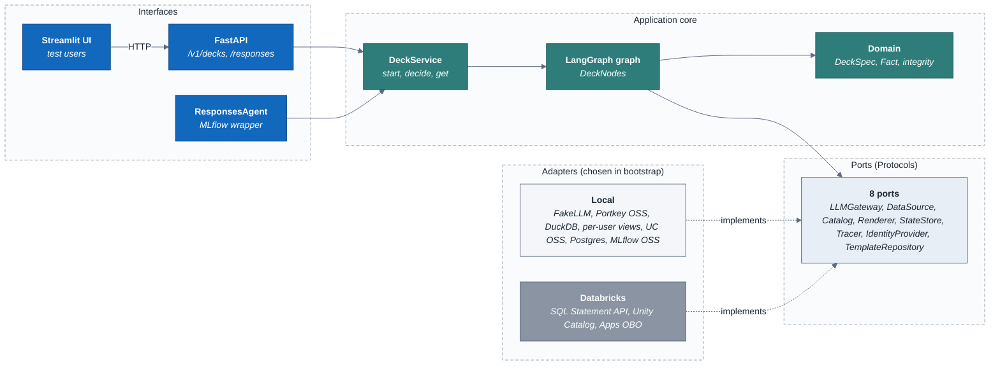
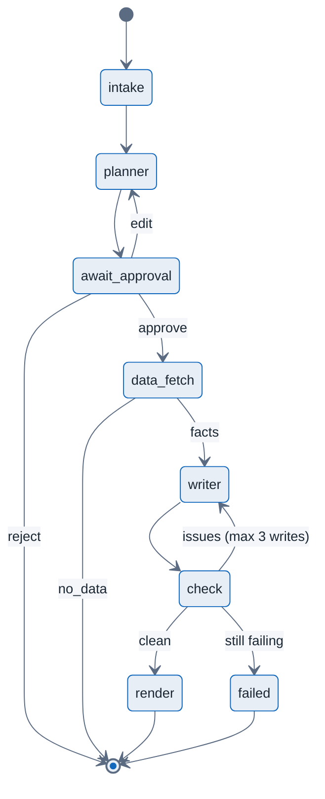
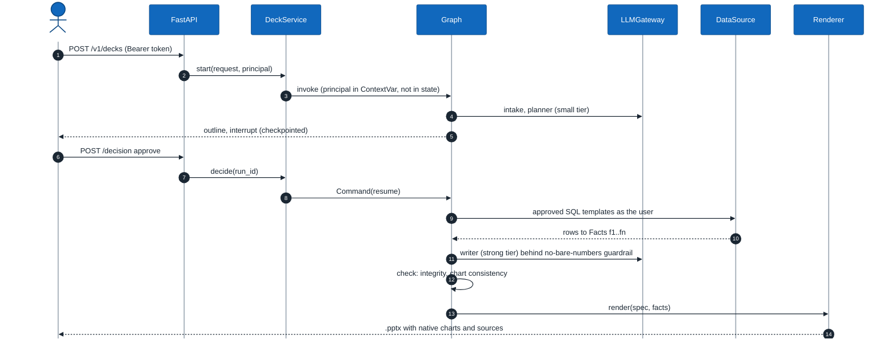
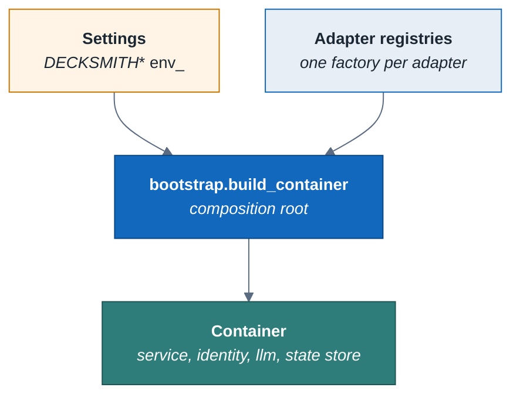

# Architecture

DeckSmith-local is the DeckSmith agent with its infrastructure swapped for local stand-ins. The [design summary](README.md#the-design-in-brief) in the README explains what DeckSmith is.  The [decision records](docs/decisions.md) and the [test plan](docs/test-plan.md) complete the design.

The code uses ports and adapters, also called hexagonal architecture. The agent's logic depends only on small interfaces called ports. Every concrete technology sits behind one of those ports. That means the same graph can run on DuckDB with a fake LLM in CI, or on the Databricks SQL Statement API with on-behalf-of (OBO) user tokens, and the only thing that changes is configuration.

## Contents

- [Layers](#layers)
- [Ports and their adapters](#ports-and-their-adapters)
- [The graph](#the-graph)
- [A request end to end](#a-request-end-to-end)
- [SOLID, principle by principle](#solid-principle-by-principle)
- [How production controls are emulated locally](#how-production-controls-are-emulated-locally)
- [Adding an adapter](#adding-an-adapter)

## Layers

*Interfaces call the application core, which depends only on ports; local and Databricks adapters implement the same ports.*

| Layer | Package | May import |
| --- | --- | --- |
| Domain | `decksmith.domain` | Standard library and pydantic only |
| Ports | `decksmith.ports` | Domain |
| Application | `decksmith.application` | Domain, ports, LangGraph, sqlglot |
| Adapters | `decksmith.adapters.local`, `decksmith.adapters.databricks` | Domain, ports, their own SDKs; never each other |
| Composition root | `decksmith.bootstrap` | Everything; it is the only module that imports adapters |
| Interfaces | `decksmith.interfaces` | Application, bootstrap |

`tests/architecture/test_dependencies.py` enforces this table. It parses every module's imports, and CI fails when a layer reaches outward.

## Ports and their adapters

| Port | What it does | Local adapters | Databricks adapter |
| --- | --- | --- | --- |
| `LLMGateway` | One gateway for every model call | `FakeLLM` (CI), `PortkeyGateway` (Portkey OSS, Ollama then Bedrock) | `PortkeyGateway` pointed at Portkey Enterprise hybrid |
| `DataSource` | Runs approved SQL as the user | `DuckDBDataSource` (read-only attach) | `DatabricksSqlDataSource` (SQL Statement Execution API with the user's token) |
| `Catalog` | Logical table name to the object this user may query | `PerUserViewCatalog`, optionally wrapped by `UnityCatalogOssCatalog` | `UnityCatalogPassthrough` (UC enforces row filters) |
| `TemplateRepository` | Approved, parameterised SQL templates | `FileTemplateRepository` (`src/decksmith/sql/templates/*.sql`) | Same files |
| `Renderer` | DeckSpec plus facts to `.pptx` | `PptxRenderer` (python-pptx, native charts) | Same |
| `StateStore` | LangGraph checkpoints | `InMemoryStateStore`, `PostgresStateStore` | `PostgresStateStore` pointed at Lakebase |
| `Tracer` | One span per node | `NoopTracer`, `MlflowTracer` (MLflow OSS) | `MlflowTracer` (managed MLflow) |
| `IdentityProvider` | Request headers to a `Principal` | `StaticTokenIdentity` (alice, bob, carol), `JwtIdentity` | `DatabricksAppsIdentity` (`x-forwarded-access-token`) |

You select each adapter with a `DECKSMITH_*` variable (see [.env.example](.env.example)). The SQL templates are written once, in Databricks SQL. `SqlCompiler` transpiles them with sqlglot for DuckDB; on Databricks the step does nothing.

## The graph

*The DeckSmith graph: human approval interrupt, no-data exit, and a bounded writer and QA loop.*

There are three rules the graph enforces:

- **The LLM never writes SQL.** The planner picks a template ID and gives parameters as strings. `validate_params` checks those parameters against each template's types and patterns before any query runs.
- **The LLM never writes numbers.** Only `data_fetch` creates `Fact` objects. The writer must refer to a number as `{{fact:fN}}`. Two checks catch bare digits: the `NoBareNumbersGuardrail` gateway decorator, which stands in for Portkey's guardrail and returns status 446, and the deterministic `check` node. Either one sends the run back to the writer. The writer gets three attempts in total; after that the run fails and no deck is rendered.
- **No data means no deck.** If none of the requested queries returns rows the user is allowed to see, the run ends with `no_data` and a plain explanation. It never produces an empty deck.

## A request end to end

*One request: outline, approval, facts from approved SQL as the user, guarded writing, deterministic checks, rendering.*

The `Principal`, which carries the user's token, travels in a `ContextVar` (`application/context.py`). It is never stored in graph state, so the token is never written into a checkpoint.

## SOLID, principle by principle

**Single responsibility.** Each class has one reason to change:

- `SqlCompiler` resolves table names and transpiles SQL.
- `FactFetcher` turns query rows into `Fact` objects.
- `DeckNodes` holds one method per graph step.
- `DeckService` holds the use cases: start, decide and get.
- `PptxRenderer` only renders.
- The numeric-integrity rules are pure functions in `domain/integrity.py`.

**Open/closed.** Behaviour is extended without editing the core:

- The bare-number guardrail is a decorator around any `LLMGateway`.
- `UnityCatalogOssCatalog` is a decorator around any `Catalog`.
- A new backend means a new adapter plus one factory in `bootstrap.py`. Nothing in `domain`, `ports` or `application` changes.

**Liskov substitution.** The local and Databricks adapters satisfy the same `Protocol`, with the same error contract:

- Access problems raise `AccessDenied`.
- Bad credentials raise `AuthenticationError`.

`test_adapters_satisfy_ports` checks both sides of each port. `tests/contract/` goes further: it runs the same behavioural assertions against every offline-constructible adapter of a port. The application has no branches by environment.

Every domain error carries a stable `code`, `category`, `status_code` and `retryable` flag (see [docs/errors.md](docs/errors.md)). The API maps errors only from those attributes, so a new error needs no interface change. Logs are JSON lines with the `run_id` bound per run, and `Settings` rejects invalid adapter combinations at start-up (decisions D10 and D11).

**Interface segregation.** There are eight small ports, not one "platform" object:

- The renderer knows nothing about SQL.
- The data source knows nothing about LLMs.
- `StateStore` exposes only `checkpointer()` and `close()`.

**Dependency inversion.** The application depends on abstractions in `decksmith.ports`. Concrete classes are created in one place, the composition root:

*Settings choose one adapter per port; bootstrap is the only place concrete classes are built.*

Tests use the same root and override only what they need. For example, `build_container(settings, llm=FakeLLM({"writer": ["bare_digit"]}))` drives the QA loop.

## How production controls are emulated locally

| Production control | Local stand-in | Fidelity |
| --- | --- | --- |
| UC row filters by region | One view per user and table (`v_<table>__<user>`). No view means `AccessDenied`. | Same results for the three test users. The emulation is not a security boundary [A]. |
| Apps OBO token | Static bearer tokens (`alice-token`, and so on) or HS256 JWTs | Same `Principal` shape. Real OBO is scenario E10, tier L3. |
| Lakebase checkpoints | Postgres 18 with LangGraph `PostgresSaver` | Same saver. |
| Managed MLflow | MLflow 3 OSS server with a Postgres store | Same tracing and `genai.evaluate` APIs. |
| Portkey Enterprise hybrid | Portkey OSS gateway; configs sent inline in `x-portkey-config` | No stored configs, budgets or virtual keys locally. The 446 guardrail is emulated in code. |
| Databricks SQL warehouse | DuckDB with sqlglot transpiling Databricks SQL | Parity is scenario E9, tier L3, and has not been verified yet. |
| S3 or UC volumes | RustFS (S3-compatible). Docker Hub no longer serves `minio/minio`, so RustFS replaces MinIO. | S3 API only. |

## Adding an adapter

1. Implement the port's `Protocol` in `adapters/local/` or `adapters/databricks/`. Raise the domain errors, not SDK errors.
2. Add a factory to the matching registry in `bootstrap.py`, and add a `Literal` value in `config.py`.
3. Add unit tests, and add the adapter to its port's suite in `tests/contract/`. Use `httpx.MockTransport` or a stub client; no network. If the adapter needs other settings, add a rule to the validator in `config.py`.
4. Run `make check`. The architecture test will catch any import that crosses a layer.
