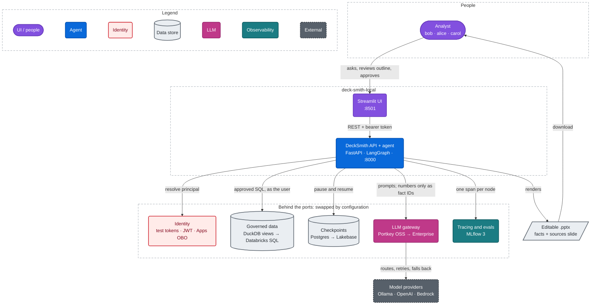
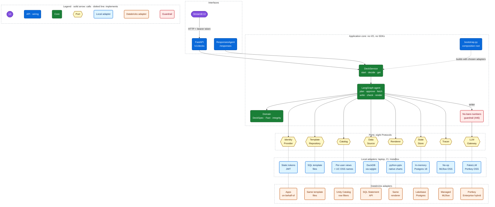
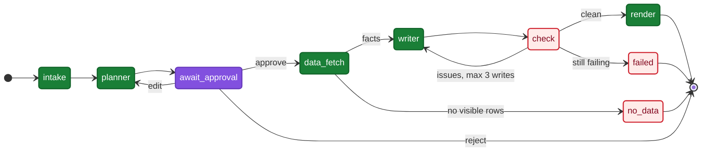
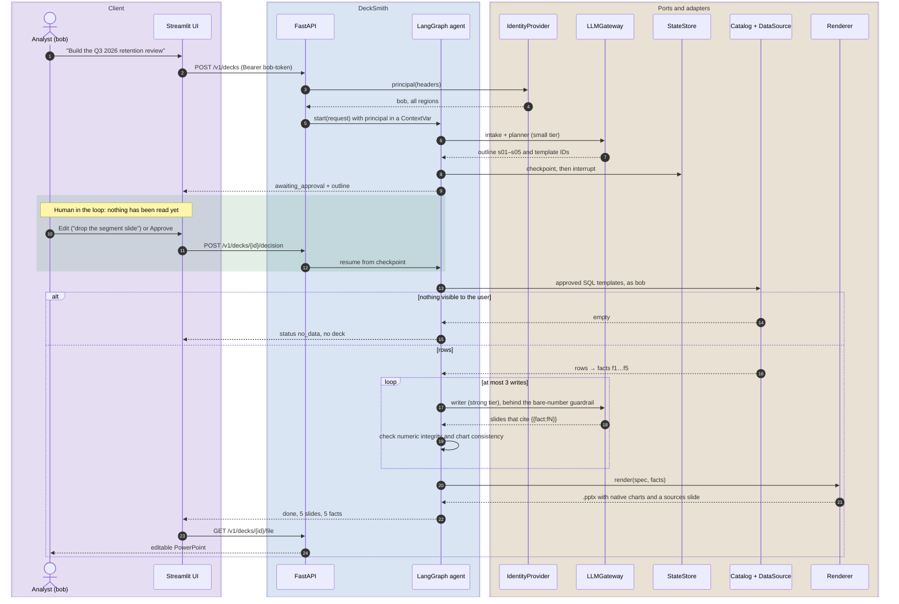
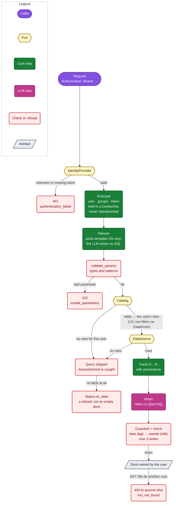
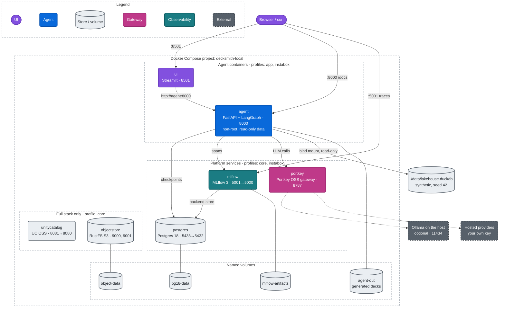
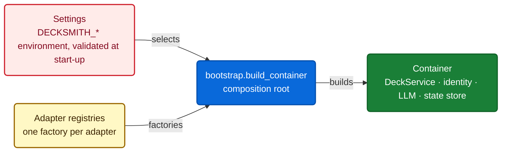

# Architecture

DeckSmith Local is the DeckSmith agent with its infrastructure swapped for local stand-ins. The agent's logic depends only on small interfaces called **ports**, and every concrete technology sits behind one of them in an **adapter**. The same graph runs on DuckDB with a fake LLM in CI, or on the Databricks SQL Statement API with on-behalf-of user tokens, and only configuration changes.

The [README](README.md#why) explains what DeckSmith is for. The [decision records](docs/decisions.md) and the [test plan](docs/test-plan.md) complete the design.

## Contents

- [Colour key](#colour-key)
- [System context](#system-context)
- [Ports and adapters](#ports-and-adapters)
- [The agent graph](#the-agent-graph)
- [A request, end to end](#a-request-end-to-end)
- [Security and permissions](#security-and-permissions)
- [Deployment](#deployment)
- [SOLID, principle by principle](#solid-principle-by-principle)
- [How production controls are emulated locally](#how-production-controls-are-emulated-locally)
- [Adding an adapter](#adding-an-adapter)
- [Editing the diagrams](#editing-the-diagrams)

## Colour key

Every diagram in this repository uses one semantic palette. Node colours are fixed, so they read the same in GitHub's light and dark themes; lines, labels and group outlines follow the theme.

| Colour | Class | Meaning |
| --- | --- | --- |
| Purple | `ui` | People and the Streamlit UI |
| Blue | `app` | API, agent runtime and the composition root |
| Green | `core` | Domain and application core |
| Amber | `port` | Ports (Python `Protocol`s) |
| Light blue | `local` | Local adapters (laptop, CI, InstaBox) |
| Orange | `dbx` | Databricks adapters |
| Grey | `store` | Data stores, volumes and artefacts |
| Magenta | `llm` | LLM gateway and model calls |
| Teal | `obs` | Observability (MLflow) |
| Dark grey, dashed | `ext` | External systems |
| Red | `sec` | Security checks, guardrails and refusals |

## System context

The LLM never writes SQL and never types a number: it picks approved templates, and every figure in its output is a `{{fact:fN}}` reference that the renderer fills in. Every box under "Behind the ports" has a local and a Databricks implementation.

## Ports and adapters

| Layer | Package | May import |
| --- | --- | --- |
| Domain | `decksmith.domain` | Standard library and pydantic only |
| Ports | `decksmith.ports` | Domain |
| Application | `decksmith.application` | Domain, ports, LangGraph, sqlglot |
| Adapters | `decksmith.adapters.local`, `decksmith.adapters.databricks` | Domain, ports, their own SDKs; never each other |
| Composition root | `decksmith.bootstrap` | Everything; it is the only module that imports adapters |
| Interfaces | `decksmith.interfaces` | Application, bootstrap |

`tests/architecture/test_dependencies.py` enforces this table. It parses every module's imports, and CI fails when a layer reaches outward.

| Port | What it does | Local adapters | Databricks adapter |
| --- | --- | --- | --- |
| `LLMGateway` | One gateway for every model call | `FakeLLM` (CI), `PortkeyGateway` (Portkey OSS: Ollama, or a hosted provider with your key) | `PortkeyGateway` pointed at Portkey Enterprise hybrid |
| `DataSource` | Runs approved SQL as the user | `DuckDBDataSource` (read-only attach) | `DatabricksSqlDataSource` (SQL Statement Execution API with the user's token) |
| `Catalog` | Logical table name to the object this user may query | `PerUserViewCatalog`, optionally wrapped by `UnityCatalogOssCatalog` | `UnityCatalogPassthrough` (UC enforces row filters) |
| `TemplateRepository` | Approved, parameterised SQL templates | `FileTemplateRepository` (`src/decksmith/sql/templates/*.sql`) | Same files |
| `Renderer` | DeckSpec plus facts to `.pptx` | `PptxRenderer` (python-pptx, native charts) | Same |
| `StateStore` | LangGraph checkpoints | `InMemoryStateStore`, `PostgresStateStore` | `PostgresStateStore` pointed at Lakebase |
| `Tracer` | One span per node | `NoopTracer`, `MlflowTracer` (MLflow OSS) | `MlflowTracer` (managed MLflow) |
| `IdentityProvider` | Request headers to a `Principal` | `StaticTokenIdentity` (alice, bob, carol), `JwtIdentity` | `DatabricksAppsIdentity` (`x-forwarded-access-token`) |

You select each adapter with a `DECKSMITH_*` variable (see [Configuration](README.md#configuration)). The SQL templates are written once, in Databricks SQL. `SqlCompiler` transpiles them with sqlglot for DuckDB; on Databricks the step does nothing.

## The agent graph

The graph enforces three rules:

- **The LLM never writes SQL.** The planner picks a template ID and gives parameters as strings. `validate_params` checks them against each template's types and patterns before any query runs.
- **The LLM never writes numbers.** Only `data_fetch` creates `Fact` objects. The writer must refer to a number as `{{fact:fN}}`. Two checks catch bare digits: the `NoBareNumbersGuardrail` gateway decorator, which stands in for Portkey's guardrail and returns status 446, and the deterministic `check` node. Either one sends the run back to the writer. After three writes the run fails and no deck is rendered.
- **No data means no deck.** If none of the requested queries returns rows the user may see, the run ends with `no_data` and a plain explanation, never an empty deck.

## A request, end to end

The `Principal`, which carries the user's token, travels in a `ContextVar` (`application/context.py`). It is never stored in graph state, so the token is never written into a checkpoint. Each step logs a JSON line with `run_id` and `duration_ms`, and errors follow the taxonomy in [docs/errors.md](docs/errors.md).

## Security and permissions

- **Who you are.** `StaticTokenIdentity` maps the fixed test tokens to alice (EU-West), bob (all regions) and carol (no access). `JwtIdentity` validates HS256 tokens; `DatabricksAppsIdentity` reads the on-behalf-of token that Databricks Apps forwards.
- **What you can see.** Locally, each user has one view per table (`v_<table>__<user>`) and no view means no access. On Databricks, Unity Catalog row filters do the same job. The local views are an emulation, **not a security boundary** ([SECURITY.md](SECURITY.md)).
- **Whose run it is.** Runs and files are looked up by owner, so another user gets 404, not 403, and learns nothing about the run.
- **Secrets.** A provider key for the real-LLM path comes from `DECKSMITH_LLM_API_KEY`, is held as a `SecretStr`, is filled into the gateway config in memory only, and never appears in logs or files.

## Deployment

| Profile | Services | Use it for |
| --- | --- | --- |
| `instabox` | postgres, mlflow, portkey, agent, ui (about 4.5 GB of limits) | `make quickstart-docker`, CI `stack-e2e`, 8 GB VMs |
| `core` | postgres, mlflow, portkey, unitycatalog, objectstore | The full local stack (`make up`), with the agent native or via `app` |
| `app` | agent, ui | Adding the containerised agent to `core` (`make up-app`) |

Every service has memory and CPU limits, log rotation and `no-new-privileges`, and every service in the `instabox` profile has a healthcheck. The agent and UI share one multi-stage image that runs as a non-root user and ships without pip.

## SOLID, principle by principle

**Single responsibility.** Each class has one reason to change: `SqlCompiler` resolves table names and transpiles SQL; `FactFetcher` turns query rows into `Fact` objects; `DeckNodes` holds one method per graph step; `DeckService` holds the use cases (start, decide, get); `PptxRenderer` only renders; the numeric-integrity rules are pure functions in `domain/integrity.py`.

**Open/closed.** Behaviour is extended without editing the core. The bare-number guardrail is a decorator around any `LLMGateway`, and `UnityCatalogOssCatalog` is a decorator around any `Catalog`. A new backend means a new adapter plus one factory in `bootstrap.py`; nothing in `domain`, `ports` or `application` changes.

**Liskov substitution.** Local and Databricks adapters satisfy the same `Protocol` with the same error contract: access problems raise `AccessDenied`, bad credentials raise `AuthenticationError`. `tests/contract/` runs the same behavioural assertions against every offline-constructible adapter of a port, so the application has no branches by environment. Every domain error carries a stable `code`, `category`, `status_code` and `retryable` flag, and the API maps errors only from those attributes.

**Interface segregation.** Eight small ports, not one "platform" object. The renderer knows nothing about SQL, the data source knows nothing about LLMs, and `StateStore` exposes only `checkpointer()` and `close()`.

**Dependency inversion.** The application depends on abstractions in `decksmith.ports`. Concrete classes are created in one place:

Tests use the same root and override only what they need. For example, `build_container(settings, llm=FakeLLM({"writer": ["bare_digit"]}))` drives the QA loop.

## How production controls are emulated locally

| Production control | Local stand-in | Fidelity |
| --- | --- | --- |
| UC row filters by region | One view per user and table (`v_<table>__<user>`); no view means `AccessDenied` | Same results for the three test users. The emulation is not a security boundary |
| Apps OBO token | Static bearer tokens (`alice-token`, and so on) or HS256 JWTs | Same `Principal` shape. Real OBO is scenario E10, tier L3 |
| Lakebase checkpoints | Postgres 18 with LangGraph `PostgresSaver` | Same saver |
| Managed MLflow | MLflow 3 OSS server with a Postgres store | Same tracing and `genai.evaluate` APIs |
| Portkey Enterprise hybrid | Portkey OSS gateway; configs sent inline in `x-portkey-config` | No stored configs, budgets or virtual keys locally. The 446 guardrail is emulated in code |
| Databricks SQL warehouse | DuckDB with sqlglot transpiling Databricks SQL | Parity is scenario E9, tier L3, not yet verified |
| S3 or UC volumes | RustFS (S3-compatible), because Docker Hub no longer serves `minio/minio` | S3 API only |

## Adding an adapter

1. Implement the port's `Protocol` in `adapters/local/` or `adapters/databricks/`. Raise the domain errors, not SDK errors.
2. Add a factory to the matching registry in `bootstrap.py`, and add a `Literal` value in `config.py`.
3. Add unit tests, and add the adapter to its port's suite in `tests/contract/`. Use `httpx.MockTransport` or a stub client; no network. If the adapter needs other settings, add a rule to the validator in `config.py`.
4. Run `make check`. The architecture test catches any import that crosses a layer.

## Editing the diagrams

The diagrams are Mermaid, so GitHub renders them natively in both themes. Keep three rules:

- Use only the classes in the [colour key](#colour-key), copied verbatim from `PALETTE` in [`scripts/diagrams.py`](scripts/diagrams.py).
- Don't add a `%%{init}%%` theme; it would break dark mode.
- Give each diagram a `%% diagram: <name>` line and a `%% caption:` line.

`make diagrams` checks the palette and renders every diagram with mermaid-cli in the default and dark themes; it needs Node.js for `npx`, or `MMDC` pointing at an installed `mmdc`. To preview one diagram as PNGs, run `python scripts/diagrams.py --png out/diagrams --only hexagonal`.
