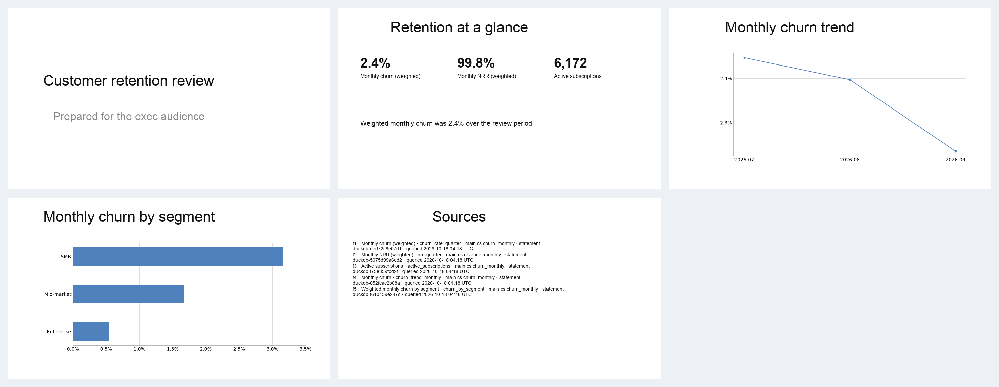

# Design rationale

DeckSmith decks are native, editable PowerPoint files. The visual system below is what makes those files read like a deck from a consulting or design team, while every number still comes from a fact.

The sample the renderer produces now, and the previous default:




The same layouts in each theme:

- [Meridian](examples/layout-gallery-meridian.png) ([pptx](examples/layout-gallery-meridian.pptx))
- [Harbor](examples/layout-gallery-harbor.png) ([pptx](examples/layout-gallery-harbor.pptx))
- [Graphite](examples/layout-gallery-graphite.png) ([pptx](examples/layout-gallery-graphite.pptx))

## What a professional deck is doing

An executive deck is an argument, not a stack of topics.

- **Action titles.** The title is the takeaway, written as one sentence. A reader who only flips through the titles should get the story. Topic labels ("Market overview") do not do that work. Sources: [Slideworks on McKinsey-style action titles](https://slideworks.io/resources/how-to-write-action-titles-like-mckinsey), [consulting slide standards](https://deckary.com/blog/consulting-slide-standards), [headings that state claims](https://msdbok.github.io/content/material/snc1.html).
- **One message per slide.** If the title needs "and", it is probably two slides. The body exists to support the title, not to add a second argument. Same sources as above.
- **Pyramid structure.** The answer comes first. Under it, a few grouped reasons. Under those, the evidence. Barbara Minto's [Pyramid Principle](https://www.barbaraminto.com/) is the usual reference; [this walkthrough](https://deckary.com/blog/pyramid-principle-consulting) applies it to slides. DeckSmith keeps the cover as the name of the work, then each content slide states one claim, then the sources appendix holds the backup.

The offline planner follows that shape. A board audience inserts a section divider after the cover. An explicit ask for an agenda, a comparison, a timeline, a quote or a split view adds that layout. The writer may improve a title, and it may not introduce a digit that did not come from a fact.

## Grid, type and colour

Slides are 13.333 by 7.5 inches (16:9). Content sits on a 12-column grid with 0.62 inch margins and 0.18 inch gutters. KPI cards, comparison columns and the two-content split are column spans, so the same edge alignment shows up on every slide. A grid is what keeps variety from becoming noise ([Nielsen Norman Group on grids](https://www.nngroup.com/articles/using-grids-in-interface-designs/)).

Type is a pair, not a single default face:

| Role | Face | Use |
| --- | --- | --- |
| Display | Georgia | Titles, big numbers, section openers |
| Body | Calibri | Labels, bullets, axis text, footnotes |

Georgia carries the editorial voice. Calibri stays readable at 11–14 pt in labels and notes. Sizes step down a short scale (about 44 / 28 / 18 / 14 / 12) rather than a new size on every slide. [Practical Typography](https://practicaltypography.com/summary-of-key-rules.html) is the rule of thumb: a few sizes, real hierarchy, body text that is not tiny.

Colour is three themes, chosen with `DECKSMITH_THEME`:

| Theme | Character |
| --- | --- |
| `meridian` (default) | Warm paper, Georgia titles, a split cover, a copper column motif |
| `harbor` | Sea-green field, Calibri titles, a horizon line, a full-width rule under each title |
| `graphite` | Paper with a black masthead, Arial titles, a blue accent and a rust highlight, a lattice |

Text on paper and on the cover meets WCAG 2.2 contrast for body copy (4.5:1). Accent and series colours meet the 3:1 non-text threshold against the paper and the card. The checks live next to the tokens and run in unit tests. References: [contrast minimum](https://www.w3.org/WAI/WCAG22/Understanding/contrast-minimum.html), [non-text contrast](https://www.w3.org/WAI/WCAG22/Understanding/non-text-contrast.html).

The accent is used once per idea: the cover rule, the highlight on a chart, the index on an agenda. It is not a second palette.

## Charts

Edward Tufte's data-ink argument ([The Visual Display of Quantitative Information](https://www.edwardtufte.com/tufte/books_vdqi)) and Cole Nussbaumer Knaflic's practice ([axis versus data labels](https://www.storytellingwithdata.com/blog/2017/8/2/axis-vs-data-labels), [strip away the non-essential](https://www.storytellingwithdata.com/blog/2019/9/19/strip-away-nonessential)) drive the chart style:

- No chart title inside the plot. The slide title already says the point.
- No legend when there is one series.
- No value axis when every point is labelled and there are at most six categories. The labels are the scale.
- A quiet value axis and light horizontal gridlines return when there are many points or more than one series, because labels would collide.
- One point is emphasised. On a line that is the latest category. On a bar or column it is the extreme value, and a tie keeps the earliest category. A study summarised by storytelling with data found that decluttering reads as more professional, and a deliberate focus improves recall ([declutter and focus](https://www.storytellingwithdata.com/blog/2022/2/1/swdchallenge-declutter-and-focus)).
- Bars include zero. A line is scaled to the data, with room above and below the series, so a label can sit beside the last point instead of on the marker or the category axis.
- A year-month category such as a fact key is drawn as a short month name. The fact itself is unchanged, and the speaker notes still carry the query.
- Charts are native PowerPoint charts. The workbook is still in the file and the series can be edited.

## Slide types

| Layout | When the planner chooses it | What the painter draws |
| --- | --- | --- |
| `title` | The cover | The theme's cover: split, banner, or masthead, plus its motif |
| `section` | A board divider, or a chapter break | Full-bleed cover colour, one line, a short rule |
| `agenda` | The request asks for an agenda | Roman indices, one entry per line |
| `kpi` | Headline figures | Cards, an optional sparkline and direction mark, an optional callout |
| `chart` | A trend or a breakdown | Styled native chart, one highlighted point, short month labels |
| `bullets` | A short argument | Accent marks, not a default bullet list |
| `two_content` | Two groups of points | Two full-height cards with accent headers |
| `comparison` | A side-by-side | Two full-height cards, each with an index and a header |
| `timeline` | A sequence or a roadmap | A full-height card per step, name at the top and detail at the foot, joined by a rail |
| `quote` | The request asks for a line | A full-width quotation card and an attribution |
| `table` | Categories against one or more series | A header and one row per category, stretched to the content area, values from the series |
| `summary` | Three takeaways | Three full-height cards, each with a large roman index and one takeaway |
| `appendix_sources` | Always, last | One row per fact: id, label, template, tables |

Footers are the same on content slides: a hairline, a one-line source list taken from fact labels, and a roman folio. The cover and section slides carry the folio only. Arabic digits on the slide face are reserved for figures that trace to a fact, so page marks never look like a metric. Speaker notes still hold the full provenance: statement id, query time, SQL, parameters and template hash. The face of the slide stays readable; the notes are the audit trail.

Text is fitted before it is drawn. The renderer picks the largest size that wraps inside the box, down to a floor. Below that floor the slide is reported in `overflow_slides`. A bullet block longer than 520 characters is flagged even if the type could shrink further: an executive slide that only works at an unreadable size is still too dense.

## Variety without chaos

The layouts differ in structure (a card row, a chart, a timeline, a quotation, a table) and share the same margin, title position, footer and type scale. The title rule and the cover change with the theme. That is the difference between a system and a set of templates. Tools such as [Gamma](https://gamma.app/), [Beautiful.ai](https://www.beautiful.ai/) and [Pitch](https://pitch.com/) do the same thing with constraints: the content chooses a smart layout, and the theme stops the layouts from drifting apart. DeckSmith's version of that constraint is the layout registry plus one theme object.

## What python-pptx can and cannot do

[python-pptx](https://python-pptx.readthedocs.io/en/latest/user/slides.html) writes Office Open XML. These pieces are used because they stay native and editable:

- Blank slides as a canvas, with shapes, text and solid or gradient fills ([DrawingML](https://python-pptx.readthedocs.io/en/latest/api/dml.html)).
- Native charts, including series colour, markers, data labels, axes, gridlines and legends ([charts](https://python-pptx.readthedocs.io/en/latest/user/charts.html)).
- Speaker notes ([notes](https://python-pptx.readthedocs.io/en/latest/user/notes.html)).
- A stable slide size and core properties, so the same spec and theme hash to the same slide XML.

These are avoided:

- **Office placeholder layouts as the design.** Choosing "Title and Content" by name was the previous renderer. Placeholders fight a custom grid, inherit the default theme, and are why the old sample looked like an unstyled template. The blank layout is still chosen by name; painters draw the grid on top. Decision D15 records the change.
- **Rasterised charts or pictures of charts.** They are not editable and they hide the numbers.
- **3D, pie charts, dual axes, and chartjunk borders.** They do not earn a place in this system.
- **Embedded font files.** python-pptx does not ship a reliable font embedder. The file names Georgia and Calibri, which Office installs. A preview on a machine without those faces will substitute, which the sample image caption says.
- **A cell-level table that the writer fills with typed digits.** The `table` layout reads series facts. Row labels and cell values are formatted by the painter. The writer names the fact, and does not type the number.
- **Auto-fit performed by PowerPoint.** It depends on the host and breaks the content hash. Fitting is computed here, before the run is written.

Other open-source generators ([PptxGenJS](https://gitbrent.github.io/PptxGenJS/), [Marp](https://marp.app/)) make the same trade: a small set of primitives, a theme, and no attempt to clone the whole of PowerPoint. The Office document model itself is [PresentationML](https://learn.microsoft.com/en-us/office/open-xml/presentation/structure-of-a-presentationml-document).

## How this sits in the code

```text
DeckSpec layout
    -> LayoutRegistry
         -> one SlidePainter per layout
              -> Theme tokens
              -> fitter
              -> chart styler
    -> PptxRenderer
         notes, provenance, content hash
```

`DECKSMITH_THEME` is the setting. `PptxRenderer` takes the theme name and, optionally, a registry, so a new layout or a new theme does not require a new branch in the renderer. The planner and the writer see the layout names in the DeckSpec schema. The offline planner maps narrative roles (`cover`, `scorecard`, `trend`, `breakdown`, and the optional extras) through `domain/composition.py`, which is the same vocabulary the prompt describes.
