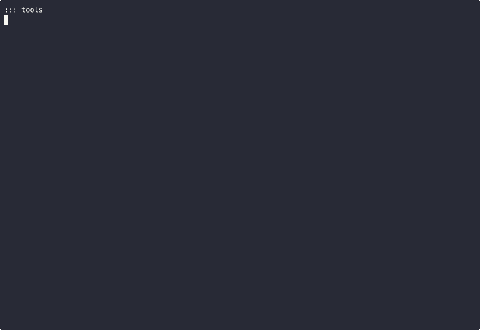
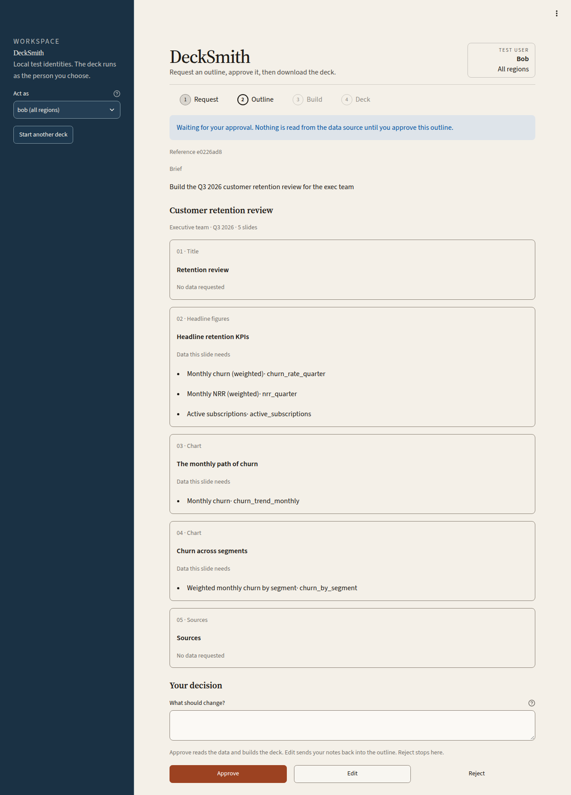
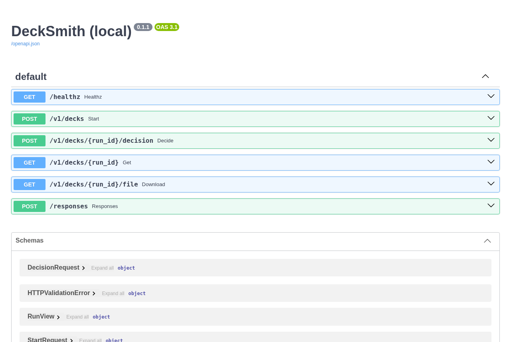
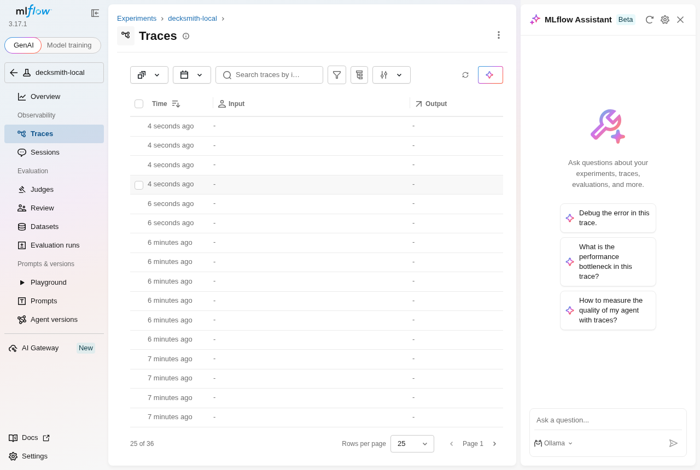
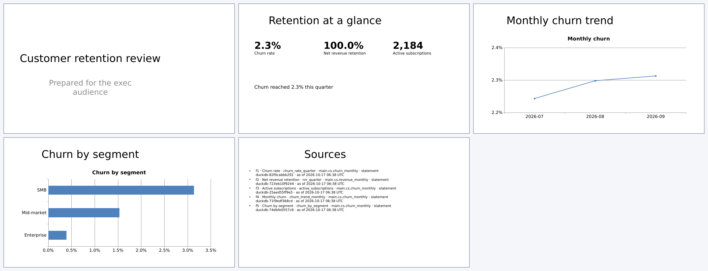

# End-to-end testing on InstaBox

[InstaBox](https://instabox.sh) gives you disposable Linux VMs with Docker preinstalled. They're a good fit for a clean-room end-to-end run of this repo, or for anyone without a 16 GB Mac.

## Facts that matter here

These were checked against the InstaBox CLI help and a live sandbox on 16 Oct 2026.

| Item | Value |
| --- | --- |
| Size | Every sandbox is 4 vCPU and 8 GB RAM, on x86_64 |
| Disks | A 16 GB system disk, plus 20 GB at `/data`. Home (`/data/home`) and `/data/workspace` live on `/data` |
| Quota | 5 sandboxes per account, in any state, plus 10 snapshots (`instabox usage`) |
| Idle | A sandbox pauses after 30 minutes idle unless `--auto-suspend 0` is set. `--timeout 70m --on-timeout kill` deletes it after a deadline |
| Software | The `universal` template ships Docker 29 with Compose, Python 3.13, git, make and uv. The bootstrap installs whatever is missing |
| Access | `instabox ssh`, `instabox exec <box> -- <cmd>` (one command, without an SSH client) and `instabox port publish` (a public HTTPS URL) |
| Automation | API keys: `instabox keys create --scope machines:read --scope machines:write --scope machines:delete`. With `INSTABOX_API_KEY` set, the CLI needs no sign-in |
| Secrets | `instabox vault set NAME` writes an environment variable into sandboxes at boot. Use it for model keys; never put them in files in this repo |

## The lean profile

The full `core` profile (Unity Catalog OSS, RustFS, and Ollama on the Mac) doesn't fit comfortably in 8 GB. The `instabox` profile runs:

- Postgres;
- MLflow;
- Portkey;
- the agent API and the Streamlit UI, both from `docker/agent/Dockerfile` and both running as a non-root user.

Its memory limits add up to about 4.5 GB; MLflow peaks around 1.6 GB while starting. `.env.instabox` selects:

- the fake LLM;
- DuckDB with per-user views;
- Postgres checkpoints;
- MLflow tracing.

To use a real model, set `DECKSMITH_LLM=portkey`. Put the provider key in the InstaBox vault and point `configs/portkey` at a hosted provider; Ollama isn't available on the VM.

## Run it

On a sandbox, as the default user:

```bash
curl -fsSL https://raw.githubusercontent.com/santoshshinde2012/deck-smith-local/main/scripts/instabox/bootstrap.sh \
  | DECKSMITH_REF=main bash
```

From your laptop, with the CLI signed in or `INSTABOX_API_KEY` exported:

```bash
instabox create --name decksmith-e2e --template universal --auto-suspend 0 --timeout 90m --on-timeout kill
instabox exec decksmith-e2e -- 'curl -fsSL https://raw.githubusercontent.com/santoshshinde2012/deck-smith-local/main/scripts/instabox/bootstrap.sh -o ~/bootstrap.sh && chmod +x ~/bootstrap.sh && (setsid nohup ~/bootstrap.sh > ~/run.log 2>&1 < /dev/null &)'
instabox exec decksmith-e2e -- 'tail -n 40 ~/run.log'      # repeat until the summary appears
instabox rm decksmith-e2e
```

Each `instabox exec` ends after a time limit, so the script runs in the background and you poll it with short calls. A full run takes roughly 10 to 15 minutes; most of that is pulling and building images.

## What the bootstrap does

1. Installs any missing tools, and Docker if it's absent. Moves Docker's data root to `/data/docker`, because the system disk is small.
2. Clones the repo into `/data/workspace/deck-smith-local` and checks out `DECKSMITH_REF`.
3. Runs `make install` (uv, locked), copies `.env.instabox` to `.env`, then runs `make seed`.
4. Runs `make up-instabox`, which builds the images and waits for every healthcheck.
5. Runs `make test`, the offline suite with the coverage gate.
6. Runs `make e2e-stack`: the E1–E8 scenarios against real Postgres, with the live-service tests, writing `out/e2e-junit.xml`.
7. Runs `make smoke-api`: curl drives the containerised agent. bob gets a deck, carol is refused, alice can't read bob's run, and an anonymous caller gets 401.
8. Runs `make demo` with Postgres checkpoints and MLflow tracing, then `make e2e-usecase`. That is the 11-step use case from the README, run against the containerised API.
9. Writes `out/instabox-summary.md` (machine, versions, step timings, container memory) and prints it. The script exits non-zero if any step fails.

## From GitHub Actions

The workflow `instabox-e2e` (run manually) creates a VM, runs the bootstrap against a ref, adds the summary to the job summary, and always deletes the VM. The VM's own timeout deletes it too, if the job dies.

The workflow needs the repository secret `INSTABOX_API_KEY`, an API key with the `machines:*` scopes. Add it under **Settings → Secrets and variables → Actions**. It's never stored in the repo.

The same lean profile also runs on every pull request on a GitHub runner, in the `stack-e2e` job of `ci`.

## Evidence from a real run

This was recorded on 17 Oct 2026 on a fresh InstaBox sandbox (4 vCPU, 8 GB), running `bootstrap.sh` on commit `e74e5f4`. Every step passed in 141 s:

- offline tests: 91 passed, 3 skipped;
- live-stack e2e: 17 tests, 0 failures, 3 skipped;
- API smoke test and demo: ok.



The full terminal session is in [`evidence/instabox-bootstrap.cast`](evidence/instabox-bootstrap.cast). Play it with `asciinema play docs/evidence/instabox-bootstrap.cast`.

| Streamlit UI: bob's outline, waiting for approval | API docs (`/docs`) |
| --- | --- |
|  |  |
| **MLflow 3: traces for the `decksmith-local` experiment** | **The generated deck, rendered with LibreOffice** |
|  |  |

How these were made:

- Playwright drove headless Chromium on the VM, against `localhost`.
- `asciinema rec` recorded the terminal, `agg` turned it into the GIF, and LibreOffice and `pdftoppm` rendered the deck.

`instabox port publish <box> 8000` also works. It gave a public `https://8000-<id>.instabox.tech` URL that answered `/healthz` (200), `/docs` (200) and an anonymous deck request (401). The URL is public and the test tokens are fixed, so unpublish it straight after use: `instabox port unpublish <box> 8000`.

In this version each graph node is logged as its own short MLflow trace (for example `render`, about 43 ms), tagged with the `run_id`. They are not yet nested under a single trace per run.
